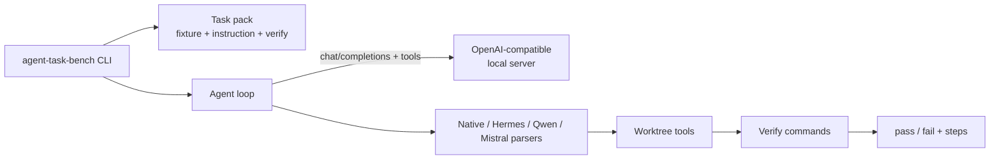

# agent-task-bench

A small Python harness for comparing OpenAI-compatible local models on tool-calling and short software-engineering agent tasks.

## What it is

The harness talks to a local or remote OpenAI-compatible `/v1/chat/completions` endpoint, gives the model a small worktree and four tools (`list_dir`, `read_file`, `edit_file`, `write_file`), and scores the result by running the task's verify commands.

It exists because model quality for coding agents is not "tokens per second" alone. The questions that matter are: can the model call tools in its native format, can it edit the file it was asked to edit, and do the tests pass when it is done?

## What it proves

- A reusable Python evaluation tool, with tests, that can run in GitHub Actions on Linux without a GPU.
- Family-aware tool-call parsing (native `tool_calls`, Hermes JSON, Qwen XML, Mistral `[TOOL_CALLS]`), plus tolerant JSON repair and `<think>` stripping.
- An `edit_file` implementation that accepts a unique whitespace-normalized match and puts the file's indentation back, and that refuses ambiguous edits.
- A public task pack of synthetic fixtures. The pack is a stand-in so the tool can be open-sourced without depending on a private product repository.

## Tech stack

Python 3.10+, stdlib HTTP client, pytest or unittest, GitHub Actions.



## Public task pack (pack-v1)

Three short tasks, each with a fixture, an instruction, and a verify script:

| Id | What the model must do |
| --- | --- |
| `T1_docs` | Add a missing "not in CI" test-command section to a development doc, and leave the rest alone |
| `T2_error_message` | Fix a command-specific error string without changing a sibling command, and add a test |
| `T3_http_tests` | Add tests only for health and rejection paths, including that a rejected POST leaves the count unchanged |

These are original synthetic fixtures. They are shaped like common software-engineering work (docs, a precise bug fix, tests-only coverage). They are not a copy of a private product repository.

## Historical results (private eval, 19 Nov 2026)

A related private evaluation compared local models on a six-task coding-agent set in a private repository. Those fixtures are not in this pack. The scores below are recorded to show that the harness was used for a real decision, not only for demo tasks.

First pass, before a per-model tool-call and thinking-switch fix:

| Model | Score | Notes |
| --- | --- | --- |
| Qwen3.8-27B | 4/6 | About 30 tok/s |
| Qwen3-30B-A3B (then current) | 1/6 | |
| Nemotron 3.5 Lightning 30B-A3B | 1/6 | 147 tok/s at 32k context |
| Devstral Small 2 | 1/5 | |
| Qwen3.6-35B-A3B | 0/6 | 2/6 if a tool-call repair was applied in the harness. Failed on tool-call format mismatch and ignored a text `/no_think` hint |

After the product's per-model parsers, `enable_thinking=false`, and whitespace-tolerant `edit_file` shipped, a rerun on the new path (text parsing, no native server-side tool calling) was:

| Model | Score | Notes |
| --- | --- | --- |
| Qwen3.8-27B | 3/6 | Still the best of the set; not a model switch on its own |
| Nemotron 3.5 Lightning 30B-A3B | 1/6 | 0 malformed calls |
| Qwen3.6-35B-A3B | 0/6 | Sloppy XML tool calls |
| Qwen3-30B-A3B (then current) | 0/6 | |

These figures are from the 19–20 Nov 2026 eval notes and have not been re-run since.

A later, separate evaluation of one configured agent (same private task family, 8k context, 40-step cap) found complementary failure modes: retry loops on an identical failing tool call, inexact `edit_file` matches, tests changed to match a bug, and fabricated tool results or PR links. Those observations drove harness changes included here: JSON repair, unclosed-tag parsing, think stripping, unique-match edits, and a step cap.

## Run it

```sh
python3 -m pip install -e ".[dev]"
python3 -m pytest -q

# Against a local OpenAI-compatible server (not required for the unit tests):
export ATB_BASE_URL=http://127.0.0.1:8000/v1
export ATB_MODEL=your-local-model
# Optional: ATB_API_KEY, read from the environment, never committed
python3 -m agent_task_bench.cli --format auto
```

The CLI prints a JSON summary of pass/fail and steps used. Worktrees are written under `worktrees/` (gitignored).

Unit tests do not need a model or a GPU. They cover parsers, repair, workspace safety, and a scripted (fake-model) run of T1 and T2.

## Configuration

- `--format auto|native|hermes_json|qwen_xml|mistral` selects how text tool calls are parsed. Native `tool_calls` in the response always win when present.
- `enable_thinking=false` is sent as `chat_template_kwargs` when the server supports it. Leaked `<think>` blocks are stripped from the assistant text either way.
- Eval-only adapters used in the original private harness (`QWEN_REPAIR`, `MISTRAL_ADAPT`, `MLX_FAST_TOK`) are not required for pack-v1. Repair and format selection live in the parsers themselves.

## Limits

- pack-v1 is small on purpose. It is a public starting point, not a claim that three tasks rank models in general.
- A pass means the verify script accepted the worktree. It does not mean the model's approach was clean.
- Do not commit API keys, server URLs that are not localhost examples, or private task fixtures.

## License

MIT. Author: Glen Burchfield.
